# Satellite Communications Gateway

A local educational prototype that simulates a satellite fleet, monitors telemetry, diagnoses interruptions, and requests telemetry recovery. A Go gateway connects a Python simulator to a Next.js dashboard through Protocol Buffers, gRPC, HTTP, and WebSockets.

The project demonstrates distributed communication, concurrent state tracking, bidirectional command delivery, and live browser monitoring. All satellites and failures are simulated; it does not communicate with real satellites, ground stations, or external space infrastructure.

> **Current status:** Telemetry, automated diagnostics and recovery, satellite snapshots, and live dashboard events are implemented. Local setup requires the Python dependencies and generated-code import path documented below. Tests and container configuration still contain scaffold-era inconsistencies; see [Development notes](#development-notes). Manual dashboard command controls remain disabled.

## Key features

- Seven simulated satellites with independent transmission intervals, sequence numbers, battery discharge/charging, and random telemetry outages.
- In-memory gateway registry populated by incoming telemetry, with HTTP snapshots of each satellite's latest state.
- Periodic inactivity checks, diagnostic pings, and automatic `RESUME_TELEMETRY` commands following unhealthy responses.
- Sequence-gap reporting when telemetry resumes after missed transmissions.
- WebSocket broadcasts for telemetry, diagnostics, recovery requests, acknowledgments, and resumed telemetry.
- Dashboard fleet details, network counts, connection indicators, and a live event log with category filters.
- Signal-aware service lifecycles, bounded telemetry RPCs, communication-stream reconnection, and bounded WebSocket subscriber queues.

## Technology stack

| Component | Technologies |
| --- | --- |
| Gateway | Go 1.26.0 module; gRPC-Go 1.85.0; protobuf 1.36.12; standard-library HTTP; `coder/websocket`; UUID command IDs |
| Simulator | Python ≥3.13; dataclasses; threads, locks, queues, and events; `grpcio` and `protobuf` runtimes |
| Dashboard | Next.js 16, React 19.2, TypeScript 5, App Router, React hooks, plain CSS |
| Communication | Protocol Buffers v3; unary and bidirectional streaming gRPC; HTTP JSON; WebSocket JSON |
| Development | npm lockfile, Go modules, setuptools, Ruff, unittest, ESLint, Docker Compose |

Python's runtime dependencies are currently missing from `pyproject.toml`; install them explicitly as shown below. Bazel, a database, authentication, TLS, and cloud deployment are not implemented.

## System architecture

```mermaid
flowchart LR
    subgraph Simulator[Python simulator]
        Fleet[Seven simulated satellites]
        Client[gRPC client and communication thread]
        Fleet --- Client
    end
    subgraph Gateway[Go gateway]
        RPC[gRPC server :50051]
        Tracker[In-memory tracker and inactivity monitor]
        Manager[Communication manager]
        Events[Event broadcaster]
        HTTP[HTTP and WebSocket server :18080]
        RPC --> Tracker
        Tracker -->|Diagnostic request queue| Manager
        Manager --> RPC
        Tracker --> Events
        RPC --> Events
        Manager --> Events
        Events --> HTTP
        Tracker -->|Snapshot| HTTP
    end
    Client -->|Unary gRPC: SendTelemetry| RPC
    Client <-->|Bidirectional gRPC: Communicate| RPC
    Next[Next.js server :3000] -->|HTTP GET /api/satellites rewrite| HTTP
    Browser[React dashboard in browser] -->|HTTP snapshot polling via Next.js| Next
    HTTP -->|WebSocket /ws: JSON events| Browser
```



The simulator initiates both gRPC connections. Telemetry uses individual unary requests; diagnostics and commands use a long-lived bidirectional stream shared by the simulator's fleet. The gateway stores satellite state in memory and emits events to connected browsers.

The browser polls the Next.js `/api/satellites` path every three seconds. Next.js rewrites it to `http://localhost:18080/api/satellites`. Separately, the browser connects directly to `ws://localhost:18080/ws`. Both gateway addresses are hardcoded in the dashboard source. The gateway itself has no dashboard-facing command endpoint.

## Satellite communication and recovery

### Telemetry lifecycle

The entry point creates `SAT-001` through `SAT-007`, named `Demo Satellite 1` through `Demo Satellite 7`, with intervals of **5, 6, 7, 8, 9, 11, and 13 seconds**. First transmissions become due after one interval. A monotonic-clock scheduler processes due satellites sequentially and schedules the next attempt after processing the current one; RPC delays can therefore delay other satellites.

Each generation increments the satellite's sequence number and records a protobuf observation timestamp, identity, battery percentage, connection status, expected interval (`google.protobuf.Duration`), and charging flag. Battery changes by a random 0.1–0.3 percentage points per generation, clamped to 0–100 and rounded to two decimals. Charging begins below 10%; discharge resumes once a subsequent generation sees a fully charged battery.

At each due transmission, a satellite outside an outage has an 8% chance of entering an outage lasting 1–10 of its transmission ticks. During an outage, telemetry is generated but not sent, so sequence numbers and battery state keep advancing. Outages can expire naturally or be cleared by a recovery command. This simulates suppressed telemetry, not a severed gRPC control connection: the simulator can still answer diagnostic pings.

Unary telemetry RPCs have a five-second timeout. Failures are logged; the same sample is not retried. Future scheduled samples continue. The gateway records arrival time, rather than observation time, for inactivity checks. New satellites need a positive expected interval; an invalid first interval is logged and the tracker skips the sample, although the RPC handler still returns `accepted: true`. The receipt does not currently populate its detail or sequence fields. Identity, battery range, and sequence ordering are not comprehensively validated.

### Inactivity, diagnosis, and recovery

1. The monitor runs every three times the shortest registered interval, initially using a 15-second fallback. A new registration resets the timer using the current shortest interval.
2. At each scan, a satellite with at least three elapsed expected cycles is queued for diagnosis and produces `satellite.inactive`. Detection occurs on scans, not precisely at the three-cycle boundary. Unseen satellites cannot be detected because they are not registered yet.
3. The communication manager sends a `PingRequest` over the active stream and emits `satellite.ping_sent` on successful send.
4. The simulator reports `healthy: false` for an unknown satellite or one currently in a simulated outage. Otherwise it reports `true`.
5. An unhealthy response causes the gateway to send a UUID-tagged `RESUME_TELEMETRY` command and emit `satellite.recovery_requested` on successful send. A healthy response does not trigger recovery.
6. The simulator accepts that action for known satellites, clears the outage and remaining ticks, and acknowledges `Telemetry restored`. Unknown satellites and unsupported actions receive negative acknowledgments.
7. Recovery does not immediately transmit telemetry. At the next scheduled transmission, the gateway updates its snapshot. If the new sequence exceeds the previous sequence by more than one, it emits `satellite.online` with the missed sequence range, followed by `satellite.telemetry`.

`online` events specifically mean a **sequence gap was observed**, rather than a tracked transition from inactive to healthy. An acknowledgment alone does not confirm a new telemetry sample. A network failure without a sequence gap may resume without an `online` event. Inactive satellites can be diagnosed again on subsequent scans; there is no diagnostic timeout, retry counter, or pending-recovery state machine.

```mermaid
sequenceDiagram
    participant S as Python simulator
    participant G as Go gateway
    participant B as Browser dashboard
    S->>G: SendTelemetry(sequence N)
    G-->>S: TelemetryReceipt(accepted=true)
    G-->>B: satellite.telemetry (WebSocket)
    Note over S: Simulated outage suppresses samples; sequence advances
    Note over G: Periodic scan observes at least 3 missed cycles
    G-->>B: satellite.inactive
    G->>S: PingRequest (Communicate stream)
    G-->>B: satellite.ping_sent after successful send
    S->>G: PingResponse(healthy=false)
    G-->>B: satellite.ping_response
    G->>S: Command(RESUME_TELEMETRY, UUID)
    G-->>B: satellite.recovery_requested after successful send
    S->>G: CommandAcknowledgment(accepted=true)
    G-->>B: satellite.command_acknowledged
    Note over S: Next scheduled transmission
    S->>G: SendTelemetry(sequence greater than N+1)
    G-->>B: satellite.online (missed sequence message)
    G-->>B: satellite.telemetry
    G-->>S: TelemetryReceipt(accepted=true)
```

The diagram shows the normal unhealthy-response recovery path. Independent goroutines can interleave event publication, so it is not a guarantee of exact browser event order. Natural outage expiry can bypass the command path.

### Two inactivity thresholds

Snapshot status and diagnostic escalation use different thresholds:

| Consumer | Inactive condition |
| --- | --- |
| HTTP snapshot / dashboard fleet status | Time since last arrival ≥ expected interval + 0.5 seconds |
| Diagnostic monitor | At least three expected cycles elapsed, evaluated on periodic scans |

A dashboard outage count can therefore increase before a diagnostic event appears.

## Repository structure

```text
apps/dashboard/
  app/                       Dashboard page, layout, and CSS
  components/                Reusable panel and expandable satellite row
  hooks/                     Snapshot polling and WebSocket event subscription
  types/gatewayEvent.ts      Event type names
  next.config.ts             Standalone output and gateway HTTP rewrite
services/gateway/
  cmd/gateway/main.go        Listeners, monitor startup, signal shutdown
  internal/config/          Environment-backed port configuration and tests
  internal/server/          gRPC handlers, tracker, communication manager
  internal/events/          Buffered in-memory broadcast subscriptions
  internal/httpserver/      Health, snapshot, and WebSocket handlers
  internal/model/           Snapshot and event JSON models
  gen/satellite/v1/         Generated Go protobuf/gRPC bindings
services/simulator/
  src/satellite_simulator/   Entry point, fleet model, scheduler, gRPC clients
  gen/satellite/v1/         Generated Python protobuf/gRPC bindings
  tests/                    Older scaffold tests requiring updates
  pyproject.toml            Package metadata and Ruff configuration
proto/satellite/v1/
  satellite.proto           Shared source contract
scripts/check.sh            Aggregate development checks
docs/                       Historical architecture and verification notes
docker-compose.yml          Three-service container definition
.env.example                Compose defaults
```

The gateway's `internal/grpcserver` and `internal/websocket` directories contain only older placeholder package comments; active implementations live in `internal/server` and `internal/httpserver`.

## Getting started

### Prerequisites

- Go **1.26.0 or newer**, as required by `services/gateway/go.mod`.
- Python **3.13 or newer**, with `venv` and pip.
- Node.js **22** and npm, matching the dashboard Docker image; use the committed npm lockfile.
- Optional: Docker Engine/Desktop and Compose v2 for container work, subject to the limitations below.
- Optional for regeneration: `protoc`, the Go protobuf plugins, and Python `grpcio-tools`.

The following commands assume a shell at the repository root. Run each service in its own terminal.

### 1. Start the gateway

```sh
cd services/gateway
go mod download
go run ./cmd/gateway
```

Defaults are HTTP `:18080` and gRPC `:50051`. The native gateway listens on all interfaces; Compose publishes HTTP only on host loopback. For a local-only environment, use appropriate host networking restrictions.

### 2. Install and start the simulator

```sh
cd services/simulator
python3.13 -m venv .venv
.venv/bin/python -m pip install -e '.[dev]'
.venv/bin/python -m pip install 'grpcio>=1.85.1' 'protobuf>=7.35.1'
PYTHONPATH="$PWD/gen${PYTHONPATH:+:$PYTHONPATH}" \
  GATEWAY_GRPC_ADDRESS=localhost:50051 \
  .venv/bin/python -m satellite_simulator
```

The explicit runtime installs are needed because `pyproject.toml` currently declares no runtime dependencies. The checked-in Python generated code requires gRPC ≥1.85.1 and protobuf ≥7.35.1 with a compatible runtime version. Exposing `gen` on `PYTHONPATH` makes the `satellite.v1` namespace importable; setuptools currently discovers only `src`. An editable install alone is insufficient.

The `satellite-simulator` console entry point is also defined, but needs the same generated-code import path. Do not use `--once` as a readiness check: that branch currently accesses the removed `service.satellite` attribute and raises `AttributeError`.

### 3. Start the dashboard

```sh
cd apps/dashboard
npm ci
npm run dev
```

Open [the dashboard](http://localhost:3000). For the current dashboard wiring, keep the gateway on HTTP port 18080 and open the browser on the same machine as the gateway. To use another dashboard port, run `npm run dev -- --port 3001`.

For a production dashboard build:

```sh
cd apps/dashboard
npm run build
npm start
```

The build script explicitly uses webpack. Changing gateway addresses requires source/configuration changes: the example dashboard environment variable is not read by the implementation.

### Configuration and ports

| Variable | Actual consumer | Default / behavior |
| --- | --- | --- |
| `GATEWAY_HTTP_PORT` | Go; Compose | `18080`; validated as an integer from 1–65535 |
| `GATEWAY_GRPC_PORT` | Go; Compose simulator target | `50051`; same port validation |
| `GATEWAY_GRPC_ADDRESS` | Python | `localhost:50051`; whitespace stripped, empty value rejected; Compose uses `gateway:<gRPC port>` |
| `DASHBOARD_PORT` | Compose host port mapping | `3000`; dashboard container remains on port 3000 |
| `PORT`, `HOSTNAME` | Dashboard standalone container | `3000`, `0.0.0.0` in Compose/Dockerfile |
| `SATELLITE_ID` | Present in examples/Compose only | **Unused by current Python code**; seven identities are hardcoded |
| `SIMULATOR_INTERVAL_SECONDS` | Present in examples/Compose only | **Unused by current Python code**; fleet intervals are hardcoded |
| `NEXT_PUBLIC_GATEWAY_WS_URL` | Dashboard example only | **Unused**; example still says port 8080, while the hook uses 18080 |

Go and Python read the process environment and do not load `.env` files automatically. Export overrides in the shell. Next.js supports `.env.local`, but this project does not consume a gateway URL variable. Root `.env` is used for Compose interpolation.

### Docker Compose: current limitations

The existing orchestration commands are:

```sh
cp .env.example .env
docker compose config --quiet
docker compose up --build -d
# Inspect services and logs:
docker compose ps
docker compose logs -f
# Stop the stack:
docker compose down
```

**The checked-in containers are not a working end-to-end setup without fixes:**

- The gateway Dockerfile selects Go 1.24 while its module requires Go 1.26.0. Toolchain auto-download may be needed, and its mandatory `go test ./...` build step currently fails because a test expects HTTP port 8080 rather than 18080.
- The simulator image copies only `src` and `pyproject.toml`, omits generated bindings, and does not install the undeclared gRPC/protobuf runtimes.
- The dashboard rewrite targets `localhost:18080` inside the dashboard container, where the gateway is not running. Container networking would require the `gateway` service hostname for this server-side request. The browser WebSocket address remains a separate browser-side concern.

Compose publishes dashboard and gateway HTTP ports on `127.0.0.1`; it does not publish the gRPC port to the host. A native simulator cannot reach a containerized gateway through the default Compose port mapping. Services start independently without dependency readiness ordering. Dashboard and gateway have HTTP health checks; the simulator has no health probe. Gateway health checks HTTP liveness only.

### Regenerating Protocol Buffers

Bindings are already committed under both services' `gen/satellite/v1` directories. Regenerate after changing [the shared contract](proto/satellite/v1/satellite.proto). These are manual maintenance commands, run from the repository root; regeneration is not required to start the existing code.

The checked-in Go headers identify `protoc` 7.36.2, `protoc-gen-go` 1.36.12, and `protoc-gen-go-grpc` 1.6.2. Python headers identify protobuf 7.35.1 and gRPC plugin 1.85.1. To install the plugins:

```sh
go install google.golang.org/protobuf/cmd/protoc-gen-go@v1.36.12
go install google.golang.org/grpc/cmd/protoc-gen-go-grpc@v1.6.2
export PATH="$(go env GOPATH)/bin:$PATH"
services/simulator/.venv/bin/python -m pip install 'grpcio-tools==1.85.1'
```

Install `protoc` separately with standard protobuf include files available, then generate into the directories the implementation uses:

```sh
mkdir -p services/gateway/gen services/simulator/gen
protoc -I proto \
  --go_out=services/gateway/gen --go_opt=paths=source_relative \
  --go-grpc_out=services/gateway/gen --go-grpc_opt=paths=source_relative \
  proto/satellite/v1/satellite.proto
services/simulator/.venv/bin/python -m grpc_tools.protoc -I proto \
  --python_out=services/simulator/gen \
  --grpc_python_out=services/simulator/gen \
  proto/satellite/v1/satellite.proto
```

Keep generators and runtime versions compatible and review generated diffs. No automated generation pipeline is provided. The Go module and `go_package` use `github.com/satellite-communications/gateway`; change them together if adopting another module path. The older [protobuf notes](proto/README.md) describe the scaffold and obsolete output paths.

## API and communication

### HTTP

| Method / path | Response / purpose |
| --- | --- |
| `GET /health` | HTTP 200, `{"status":"ok","service":"gateway"}`; no gRPC, simulator, or fleet readiness check |
| `GET /api/satellites` | JSON object containing a `satellites` array; empty before first telemetry; order follows Go map iteration |
| `GET /ws` | WebSocket upgrade for live gateway events |

Example local checks:

```sh
curl --fail http://localhost:18080/health
curl --fail http://localhost:18080/api/satellites
```

Illustrative snapshot response (timestamps and values vary):

```json
{
  "satellites": [
    {
      "id": "SAT-001",
      "name": "Demo Satellite 1",
      "status": "online",
      "battery_percent": 99.75,
      "sequence_number": 1,
      "last_seen": "2026-11-11T12:00:00Z",
      "expected_interval_seconds": 5,
      "charging": false
    }
  ]
}
```

There are no HTTP command routes. Cross-origin HTTP access is not configured; the dashboard uses its same-origin Next.js rewrite. WebSocket acceptance permits the request host's origin and adds `localhost:*` origin patterns.

### gRPC contract

Service: `satellite.v1.SatelliteGatewayService`.

| RPC | Shape | Purpose |
| --- | --- | --- |
| `SendTelemetry` | Unary `SendTelemetryRequest` → `TelemetryReceipt` | Submit one observation and update gateway state |
| `Communicate` | Stream `SatelliteMessage` ↔ stream `GatewayMessage` | Simulator sends ping responses and command acknowledgments; gateway sends pings and commands |

`SatelliteIdentity` contains ID and name. `SendTelemetryRequest` contains identity, `Timestamp observed_at`, battery percentage, `ConnectionStatus`, sequence number, `Duration expected_interval_seconds`, and charging. The duration field's name ends in `_seconds`, but its wire type is a protobuf Duration, not a numeric scalar. Connection status defines unspecified, connected, and disconnected values; the simulator always sends connected, while the tracker derives status from arrival timing.

`GatewayMessage` has a `oneof` containing either `PingRequest` (satellite ID) or `Command` (command ID, satellite ID, action). `SatelliteMessage` has a `oneof` containing either `PingResponse` (satellite ID, healthy) or `CommandAcknowledgment` (command ID, satellite ID, accepted, detail). `TelemetryReceipt` defines accepted, detail, and sequence number, although only accepted is currently set.

The gateway stores **one active communication stream**, not a stream per satellite or simulator. The latest stream replaces the prior reference. A single simulator multiplexes its seven satellites by ID; multiple simulator processes are not reliably routed. Transport is insecure gRPC without TLS or authentication.

### WebSocket events

Every event includes `type`, `satellite_id`, and a gateway-generated RFC 3339 JSON `timestamp`. `data` is omitted when empty. Payload fields are defined by the publishers, not by arbitrary gRPC-to-JSON serialization.

| Type | `data` fields | Trigger |
| --- | --- | --- |
| `satellite.telemetry` | `name`, `battery_percent`, `sequence_number` | Tracker records telemetry |
| `satellite.inactive` | `name`, `cycles_missed` | Periodic scan finds ≥3 missed cycles |
| `satellite.ping_sent` | None | Ping stream send succeeds |
| `satellite.ping_response` | `healthy` | Ping response received |
| `satellite.recovery_requested` | None | Recovery command stream send succeeds |
| `satellite.command_acknowledged` | `accepted`, `detail` | Acknowledgment received |
| `satellite.online` | `msg` | Higher telemetry sequence reveals skipped samples |

Illustrative messages:

```json
{"type":"satellite.telemetry","satellite_id":"SAT-001","timestamp":"2026-11-11T12:00:00Z","data":{"name":"Demo Satellite 1","battery_percent":99.75,"sequence_number":1}}
{"type":"satellite.ping_response","satellite_id":"SAT-001","timestamp":"2026-11-11T12:00:30Z","data":{"healthy":false}}
{"type":"satellite.command_acknowledged","satellite_id":"SAT-001","timestamp":"2026-11-11T12:00:31Z","data":{"accepted":true,"detail":"Telemetry restored"}}
{"type":"satellite.online","satellite_id":"SAT-001","timestamp":"2026-11-11T12:00:35Z","data":{"msg":"Missed telemetries: 2 - 6"}}
```

Command IDs are carried by gRPC but omitted from WebSocket acknowledgment events. Charging and expected interval appear in HTTP snapshots, not telemetry events. The WebSocket reader discards client messages; it does not implement commands or subscriptions. Events are live-only, with no replay or persistence. Each subscriber has a 100-event buffer; full buffers drop new events rather than block the gateway. Writes have a five-second timeout.

## Dashboard

- **Fleet:** Polls snapshots immediately and every three seconds, sorts by name, and displays ID, name, and derived online/inactive status. Expand a row for battery/charging, sequence number, last arrival in local time, and expected interval. Battery colors use ≤20%, <50%, and ≥50% thresholds.
- **Event log:** Shows newest events first, retains at most 1,000 events in browser memory, and displays local timestamps. Filters select all events, telemetry, diagnostics (inactive/ping sent/ping response), or recovery (request/acknowledgment/online).
- **Network overview:** Shows gateway fetch success, online satellite count, and remaining registered satellites as active outages. The gateway indicator is based on the snapshot fetch error state; the separate live-stream indicator reflects WebSocket connectivity.
- **Reconnect behavior:** WebSocket close triggers another connection attempt after two seconds. Polling continues through HTTP failures. Missed WebSocket events are not recovered after reconnect or page reload.
- **Presentation:** Dark responsive CSS, expandable rows with keyboard focus and ARIA state, reduced-motion handling, and a scrollable activity log.
- **Controls:** Target/command selectors and send button are disabled placeholders. Automated gateway recovery works independently of these controls.

## Development notes

### Checks

After installing dependencies, run from the repository root:

```sh
(cd apps/dashboard && npm run lint && npm run typecheck && npm run build)
(cd services/gateway && go vet ./... && go test ./... && go build -o /tmp/satellite-gateway ./cmd/gateway)
(cd services/simulator && .venv/bin/ruff check . && .venv/bin/ruff format --check .)
(cd services/simulator && PYTHONPATH="$PWD/gen" .venv/bin/python -m unittest discover -s tests -v)
docker compose config --quiet
```

`sh scripts/check.sh` aggregates the older commands, including Python `--once`, but is **not currently a passing verification gate**. It also omits the Python generated-code import path. Formatting can be applied with `gofmt -w cmd internal` from the gateway directory and `.venv/bin/ruff format .` from the simulator directory.

During this README review, dashboard lint and TypeScript checks and gateway `go vet ./...` passed. Gateway tests failed because `TestLoadDefaults` still expects port 8080. Python tests first failed to import `satellite.v1` without `PYTHONPATH`; with `gen` exposed, they still failed because they use the old service constructor, placeholder expectations, and removed interval configuration. The `--once` attribute error was also reproduced. These issues are documented rather than changed in this documentation-only update. No full end-to-end run, production dashboard build, container build, or binding regeneration was performed for this review.

### Concurrency and reliability boundaries

- The gateway tracker protects its map with a mutex. It publishes events and queues diagnostics after releasing that lock. A size-one notification channel coalesces timer resets on new registrations; the diagnostic queue holds 100 satellite IDs.
- The communication manager serializes stream sends with a mutex. Stream cleanup clears only the matching active reference, avoiding removal of a replacement stream on reconnect. Its `SendRecoveryCommand` currently returns without unlocking if no stream exists, which can deadlock subsequent manager operations on that error path.
- Diagnostic enqueueing is blocking and has no cancellation branch; a full queue can stall monitoring. Blocking stream sends can also delay other communication operations. These are prototype limitations.
- The simulator uses a main scheduling loop and a daemon communication thread. A lock protects outage checks and command changes; an outgoing queue feeds the bidirectional stream. Stream failures reconnect after two seconds using an interruptible wait.
- SIGINT/SIGTERM stops the simulator scheduler and closes its gRPC channel in `finally`. The daemon communication thread is not explicitly joined. An in-flight telemetry call may take up to its five-second timeout.
- Gateway SIGINT/SIGTERM cancels the monitor context and starts HTTP shutdown and gRPC graceful stop with a shared five-second budget, forcing gRPC stop on timeout. HTTP has five-second header, ten-second read, and sixty-second idle timeouts. Upgraded WebSockets have no explicit application-wide shutdown registry.
- Unexpected HTTP serve failure calls `log.Fatal`, bypassing deferred cleanup; gRPC serve errors are logged without coordinated service termination. The startup gRPC log text is fixed to port 50051 even when configuration changes it.
- State is lost when the gateway restarts. Satellite name and expected interval are retained from first registration; subsequent samples refresh battery, sequence, arrival time, and charging. Duplicate or decreasing sequences still overwrite state. Lateness above 30% is logged for increasing sequences, based on sequence difference and expected interval; it is not a separate browser event.

### Existing documentation

[Architecture notes](docs/architecture.md), [protobuf notes](proto/README.md), and [scaffold verification](docs/verification.md) preserve useful project history but describe the initial scaffold. Their claims that gRPC, telemetry, and WebSockets are unimplemented are obsolete. Historical check results are not evidence that the current revision passes those checks. This README describes the current implementation and limitations.

## Future improvements

The following are proposals, not implemented capabilities:

- Repair Python runtime packaging, container networking/toolchain configuration, stale tests, and `--once` validation.
- Route streams per simulator/satellite and add command correlation, diagnostic deadlines, bounded retries, and cancellation-safe queues.
- Fix the recovery-manager error-path lock and add recovery/concurrency integration tests.
- Configure dashboard gateway addresses through validated environment settings.
- Add stronger telemetry validation, explicit recovery state transitions, and consistent status thresholds.
- Enable manual dashboard commands through a designed API, with authentication and authorization.
- Add durable telemetry/event storage, event replay, structured observability, and transport security.
- Introduce deterministic outage scenarios, reproducible cross-language generation, and CI; evaluate Bazel if it becomes useful.
